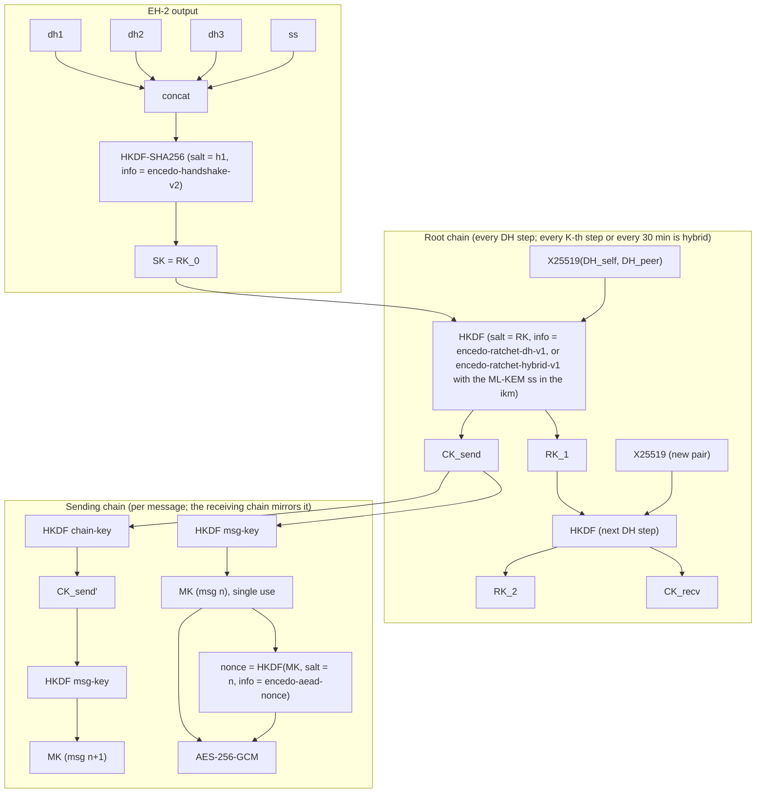
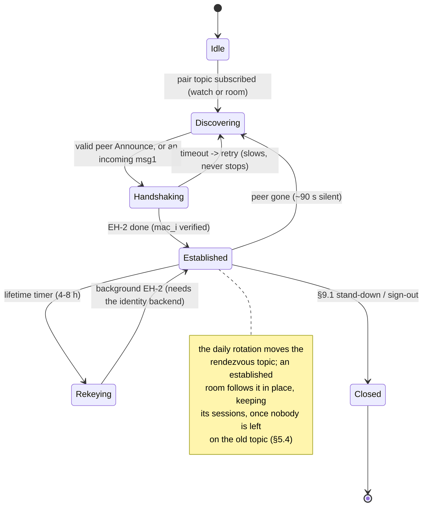

# v6 — RATIONALE.md

Why the protocol in `SPEC.md` is the way it is: the reasoning behind each area, the alternatives that were considered, the decision record, the roadmap, the open questions and the implementation map. Nothing here is normative; where this file and `SPEC.md` disagree, `SPEC.md` governs. Section numbers of the form §n refer to `SPEC.md`.

---

## 1. The model

**Synchronous, no application server.** Both parties are online for a message to cross and the network stores nothing for the text path. This one assumption removes prekey bundles, one-time-prekey pools, a prekey server, server-side history, push notifications and multi-device ratchet synchronisation — each of which is a server to run, a store to protect and a surface to audit. The remaining central points are the identity backend, the discovery nodes (transport, not storage) and, for shared files only, a store that holds ciphertext for minutes. A client may keep an outbox of its own (the terminal daemon does, §13); that changes nothing in the network.

**Single active session.** Nothing in a serverless design can synchronise ratchet state between a laptop and a phone without a coordinator, so the protocol does not try: one identity, one live session, detected and enforced by the self-topic (§9.1). History is per device.

**Contacts out of band.** Trust establishment is not solved by the protocol. A key arrives by QR, invite link or admin enrollment and is verified by comparing a safety number (§4.4.1). Key transparency and contact-discovery services are what this removes.

**Groups as sender keys over the pairwise sessions**, not pairwise handshakes per message and not MLS: at 3–5 members, up to 8–10, the pairwise redistribution on a membership change is about nine messages. MLS (RFC 9420) is deferred, not rejected: TreeKEM's O(log N) matters above roughly fifty members, and its Delivery Service is a server this design does not have.

**One engine, several shells.** The web app, the terminal client and the Tauri 2 shells consume one TypeScript engine; the shells wrap the same bundle. Electron and Cordova were replaced by Tauri 2 (one framework for desktop and mobile, a Rust host outside the webview, a smaller CVE surface). Iroh was noted as ecosystem awareness; libp2p was already integrated and nothing justified a migration.

**The two channels** — Encedo Chat (enterprise: EPA HSM, OIDC, DORA/NIS2 framing) and onchato (open public network: self-hosting, community front-ends) — are one core with different identity backends and deployment profiles (`THREAT-MODELS.md`).

---

## 2. Identity

**One X25519 key that never signs.** Deniability excludes handshake signatures; groups authenticate by ECDH-derived HMACs; topics rest on ECDH. A key declared Ed25519, even dual-flagged, would carry a capability the protocol never uses plus a Montgomery conversion per operation, and a whole class of joint-security questions in an audit. The HEM enforces purpose by hardware flag, so the separation is a property of the device rather than of implementation discipline. No key is shared with another Encedo product and no dormant key is provisioned: an unused key is not a security property.

**The KID is `SHA-1(pub)[0:16]`** because the HEM defines it so, and it is useful precisely because it is an index on key content: the same identity on another device has the same id, and the device refuses to import a key it already holds whatever DESCR it sits under. Hijacking a specific KID is a second preimage on 2¹²⁸; SHA-1's chosen-prefix collision weakness does not lower that, so truncated SHA-256 would change no attack cost here.

**No stored fingerprint in the DESCR.** Verifying `KID == SHA-1(pub)[0:16]` gives what a stored fingerprint gave without spending 32 bytes of a 128-byte record. Neither defends against an attacker who can write to the HEM, who would replace key and identifier together; the real protection is out-of-band verification at import.

**The fingerprint identifies, the safety number verifies.** `SHA-256(pub)[0:8]` is enough to tell two entries apart and to key local records. Verification is Signal's numeric fingerprint adapted: two halves, each bound to one key, rather than one hash over both. A single hash over the pair would let a man in the middle search for two key pairs of his own that collide on the displayed digits (a birthday search); a half bound to the key he does not control has to be hit exactly, at about 2¹⁰⁰ per half times the 5200 iterations. There is no stable identifier where Signal uses the phone number: the X25519 key is the identity. It is purely local; nothing travels.

**Contact-book MAC, not encryption.** The stored keys are public, so secrecy buys nothing; what matters is that a swapped key is detected, because a swapped contact key is a complete MITM with every layer below working perfectly on the key it was handed. A MAC keeps reads synchronous. The "ever signed" marker exists because without it swapping a key needed no forgery, only dropping the MAC and presenting a pre-MAC book. A `tampered` book is kept as evidence rather than overwritten.

**Software identity.** A password-sealed key on disk is the onboarding tier and the packaged clients' default, not the assurance tier. Theft of the blob plus a guessed password is the identity, and the guess is the whole attack, so the password is not left to the user where one is chosen: the client refuses under about 60 bits. The floor is not applied at sign-in or to the export: refusing there would lock someone out of an identity nobody can recover.

**Several identities in one HEM.** Contacts are scoped by the owner's KID because `key_search` is an anchored prefix match, which makes the owner id in the DESCR the entire scoping mechanism. The name is read as the whole tail because it is user-supplied and may contain the delimiter. Handles may repeat and may be renamed, so nothing is keyed by handle.

---

## 3. Rendezvous

**Circular knowledge.** A pair topic is the image of the pair secret under HKDF with the date; mapping a topic to (Alice, Bob) requires both `IK_pub`s, that is, already knowing the relationship one is looking for. Topics are indistinguishable from random without the secret.

**Self-topic.** The DH of a key with itself is computable only by the key's holder, so an observer with `IK_pub` can neither find the self-topic nor confirm presence on it. It shares the pair topic's label rather than carrying its own; domain separation comes from the ikm (a self-DH is not a pair DH). An earlier draft derived the self-topic from `IK_pub` alone, which would have leaked presence to anyone holding the public key; that draft was never implemented.

**Group topic seeds, considered and rejected.** `GK_pub` as ikm: a stored, retrievable HSM value, so a HEM dump would compute the topic. `GK` is kept as the group's identity and roster-MAC key, not the topic seed, so that a `GK_pub` leak does not expose the topic. A contributory group DH (`abc·G`): correct and HEM-native, but a multi-round synchronised ceremony re-run on every membership change, fragile over asynchronous GossipSub, for a value that is random either way.

**A per-key rotation instant, not midnight and not a per-client jitter.** A midnight rollover re-subscribes the whole user base at once on the discovery nodes. A per-client random jitter spreads the load but the two members of a pair do not share it, so they need a wide overlap window to meet. Deriving the instant from the topic's own key gives both: rotations spread uniformly over the day, and both holders cross together, so the guard shrinks to clock skew plus mesh propagation. The same rule applied to the self-DH and to `group_secret` means a topic observer cannot tell a self or group topic from a pair topic by its hop time.

**A room follows the day.** A conversation held open across a rotation keeps its topic while the other side is still on it. It used to be pinned there for its whole life, which broke a pair after one side restarted: the restarted side met the holder of the old room only through presence, never in the room. Moving the room in place, once nobody is left on the old topic or when the contact's handshake arrives on another active day's topic, keeps sessions and unconfirmed messages and changes nothing on the wire.

**Clock anchor.** Timestamps in Announces and handshakes are checked to ±5 min, and the rendezvous day is derived from the clock, so a client whose clock drifts would be refused as a replayer or would derive yesterday's topic. Reading the `Date` header of a node's `/health` answer, taken as true at the midpoint of the round trip, corrects ordinary drift; the clamp to ±10 min keeps a wrong node from dragging every client with it. The 30-minute guard remains for a client that never reached a node; with the anchor in place it can shrink, a later, measured change.

**Published invites.** Every other topic is the image of a secret two parties share; this one is the image of a secret printed on a web page, and every property follows from that. The knock has `msg1`'s shape — a one-shot ephemeral in the clear, everything else sealed to the recipient's key — because the answerer's identity key is the one thing the inviter cannot derive, and putting it in the clear would tell the first person who scraped the invite who answered it. The invite secret is the HKDF context so that a knock opens only under the invite it came through, a binding the external reviewer called important. The frame is sealed to a key of the invite's own, not to the identity key: `invite_priv` is derived from the self-DH under the invite secret, so only the identity can compute it and every window and device of the identity computes the same one, and opening a frame is then a local X25519. Sealing to `IK` made every frame a DH with the identity key, which on a HEM is a device call; the topic is public, so whoever holds the link chose how many. Every frame is exactly 348 bytes: the moment lengths vary, a decoy stops being indistinguishable from a real knock and the length of what somebody wrote stops being private. The nonce is derived rather than carried because a fresh ephemeral per frame means the key seals once; twelve bytes off a frame whose length is load-bearing. The budgets (20 knocks per minute surfaced, 512 ephemerals remembered, 512 dismissed) protect attention, not security; `name` and `note` are shown beside a fingerprint, never instead of one.

**Cover traffic.** "Somebody knocked" stops carrying information if it happens anyway. The decoy schedule must not be derivable from the invite secret: the secret is public, so every link holder could compute when the decoys fall, subtract them and read off the real knocks, leaving an observer better off than with no cover at all. Seeding from the self-DH means only the identity holder can compute the schedule; being deterministic means two windows of one identity produce one stream rather than two (the rate would otherwise reveal how many devices listen) and a restart resumes with nothing stored. 45 s is well under half the nodes' 120 s idle eviction, and the decoy doubles as the keepalive of a full GossipSub peer's inbox topic; the arithmetic that matters is the worst gap, since two consecutive decoys at uniformly random instants can fall almost two slots apart. What remains is traffic analysis against an inbox somebody chose to publish (S14).

---

## 4. Handshake

### EH-2 against Noise: what it is, and why it is not rewritten as a Noise pattern (2026-10-12)

**The mapping.** Both parties hold each other's static key before the first byte (contacts are imported out of band, §2.3), so the Noise pattern EH-2 resembles is **KK**, not XX: `-> s`, `<- s`, then `-> e, es, ss`, `<- e, ee, se`. With the ML-KEM encapsulation of msg1's `pq_pub` answered in msg2, that is **KKhfs** (the hybrid-forward-secrecy extension). Message by message the token sets line up: msg1 carries `e` and the KEM public key; msg2 carries `e`, the KEM ciphertext and the responder's authentication; msg3 carries the initiator's.

**Three deviations, each deliberate.**

1. **No `ss`.** Noise KK mixes `DH(s_i, s_r)` into the chain. EH-2 does not: its `ikm` is `DH(IK_r, EK_i) ‖ DH(EK_r, IK_i) ‖ DH(EK_r, EK_i) ‖ ss_kem`. The static-static term adds nothing to forward secrecy (both ephemerals are fresh), and leaving it out keeps the pair secret `ECDH(IK_a, IK_b)` as rendezvous-only material: it names the topic and keys the Announce MAC and never enters a message key, which is what lets §4.3 say that its exposure on current firmware costs linkability, not content. Adding `ss` would have made the rendezvous secret a session-key input.
2. **One HKDF over the concatenation** instead of Noise's chained `MixKey` calls. The combiner is the standard concatenation-in-KDF (draft-ietf-tls-hybrid-design; Bindel et al. 2019); `h1 = SHA-256(serialize(msg1))` is the salt, so every session's `SK` differs, and the transcript enters the MACs through `h2_partial` and `h3`. The security argument is made at the AKE level — a MAC-authenticated AKE whose classical component is a NIKE — rather than as a composition of CCA-secure KEMs.
3. **MAC confirmation under `SK`** (`mac_r`, `mac_i`) instead of Noise's AEAD-encrypted empty payloads. Both MACs are under a key both parties hold, which is where deniability comes from; an AEAD tag under the same key would give the same deniability, so the choice is one of explicitness.

**Why not rewrite it as Noise KKhfs literally.** Three things would be gained: a name an auditor recognises, a formal model (Noise's patterns have been analysed in Tamarin and ProVerif), and the option of taking the handshake from an audited library. Three things would be paid: `ss` returns unless the pattern is modified, and a modified pattern is no longer the analysed one; the `initiator_tag` and the responder-perspective DH ordering (§6.3) would have to be carried as extensions either way; and the shipped implementation, its known-answer vectors and its deployment would change for a construction whose properties are the same. The decision is to keep EH-2 as it is and document the mapping, so that an auditor can read it as KKhfs-minus-`ss` with explicit MACs. What would reopen this: a reviewer who can show that one of the three deviations loses a property KK has, or a decision to adopt a Noise library for the hardened tier so that the handshake comes from audited code rather than our own. The formal model given up with the literal pattern is supplied for EH-2 itself: `EH2-PROVERIF.md` (ProVerif 2.05, `docs/proverif/`) proves injective mutual agreement on identities and SK, SK secrecy, forward secrecy, KCI resistance in both roles, and SK secrecy with X25519 broken or with ML-KEM broken, with negative controls and a mutant that must be caught.

### Delivery discipline

GossipSub is fire-and-forget and a joining peer's mesh grafts over hundreds of milliseconds, so the opening frames of a handshake routinely reach nobody. Three mechanisms cover it, and removing any one brings back a hang that looks like broken crypto: the opening frame is re-sent while an attempt waits; a silent attempt times out and is retried; and after a failure either side may initiate, because a lost msg3 leaves the responder — the side that never initiates — as the only one that knows anything is wrong. The retry escalation slows but never stops: a link losing a third of its frames needs many attempts before the first handshake lands. A byte-identical msg1 gets the stored msg2 replayed because a fresh responder ephemeral would doom the initiator's `mac_i`.

### The initiator tag

A pair topic can hold more than the two people it was derived for: a second tab of the same identity derives the same topic and the same Announce key, its Announces verify, and each window takes the other for the contact. A handshake between them can never succeed, and without a stop rule the two retry each other forever. The tag is the one conclusive statement about identity: it verifies under the responder's own `IK` when the sender is a second window, and under the contact's when it is the contact. A failed MAC must not be used for this, because honest crossed handshakes produce `mac_i` failures routinely; an earlier attempt that did so blacklisted the real contact within seconds. The tag replaced `SHA-256(IK_i_pub)[0:8]` in the clear, which did the same job and was the same eight bytes in every msg1 of an identity, linkable by a node across pairs and days. Removing the hint altogether was tried: without it the first window keeps handshaking with its duplicate, every one of its msg1 is also answered by the real contact, and the contact's live session is re-keyed every few seconds.

### Erasure, stated for the auditor

`dh3` survives `SK` derivation because it is the first ratchet step's input (§7.2); `EK_i_priv` survives longest because the responder seeds the ratchet's first peer key with `EK_i_pub` from msg1, saving a round trip. `sk_i` lives inside the decapsulation closure and is dropped rather than zeroed, a JS-runtime limit; the `EK` private halves are non-extractable WebCrypto keys, droppable and usable under compromise but not exportable and not zeroable from script. This is S1.

---

## 5. Messaging

**The first root step consumes `dh3`.** Running one DH step at construction, with the handshake's `DH(EK_r, EK_i)` as ikm, gives the initiator a sending chain immediately and the responder the matching receiving chain without a round trip. A second implementation that starts from a bare `RK_0 = SK` derives nothing the shipped client can read, which is why §7.2 states it.

**The hybrid step.** Signal's SPQR carries ML-KEM material across an unreliable, size-limited push transport and therefore needs ciphertext chunking, forward error correction and a fragment state machine. Here the transport is a reliable ordered stream and a PQ key fits in one header, so a simple construction suffices: a key every K-th DH step or every T minutes, carried on every frame until answered (a frame can be lost and the peer must learn the key from whichever one arrives), the ciphertext mixed into the root at the answerer's next DH step. One outstanding key per side, and keys cannot cross because a side steps only on receiving the chain that carries the other's key. The header is the AEAD's associated data, so an adversary on the path can delay a contribution by dropping frames but never strip it. K = 4 and T = 30 min bound the window in which a quantum adversary holding a ratchet snapshot can follow the session; the lifetime timer (4–8 h) remains the hard bound and the hard stop of §9.3.

**Nonce via HKDF rather than a bare counter**, as defensive robustness against nonce-reuse bugs in an implementation: a collision needs two frames under one `MK`, which the chains never produce. The same function serves a 1:1 frame and a group frame.

**Transactional decrypt and serialised calls.** Keys are derived on the side and state advances only after the AEAD verifies; a forged frame must burn nothing. The naive version let a forged frame consume the live chain key, and a forged `dh_pub` step the root key — an unauthenticated desync. The ratchet also serialises its own calls: two encrypts issued in one tick would derive one message key twice and stamp the same `n`, and the peer's receiving chain would stay behind the sender's permanently.

**Session lifetime.** The forced re-handshake caps classical PCS exposure, is the hard stop on a stolen unlocked device (the ratchet never touches the HSM; the re-handshake does), and is randomised so a fleet does not re-key in lockstep. It is transparent: the running ratchet carries content until the replacement is live, and the replaced one is kept 60 s for frames in flight.

**Delivery contract.** Nothing under the room retransmits: GossipSub is fire-and-forget and a DataChannel can look open while swallowing everything. Acks, a widening backoff and a budget that runs only while the peer announces make the verdict about a lost frame rather than an absent peer. Running out of budget keeps the bytes for a manual re-send under the same id, so the marker the user sees is the one that turns into a confirmation. A message sent into an empty room is parked and goes out when a session comes up; before that it was silently forgotten.

**WebRTC.** A channel is trusted only after a ping/pong proves both directions, because `onopen` has lied in testing with both ends reporting a live channel while content vanished. One stall while content rides the channel demotes the conversation to the node for its remaining life; the narrower condition matters, because an ordinary GossipSub drop used to trigger the same ban and permanently punish the direct plane for the node's hiccup. The offering side re-offers because a lost offer would silently cost a conversation its direct path for its whole life.

**Payload conventions.** A reply carries the quoted text because the transcript is ephemeral and the receiver usually no longer holds the message being answered; the id still buys scrolling to the original when it is on screen. The author is a key hint, never a name, so that a message cannot assert the presence of a party outside the conversation; the reader resolves it against the participants it can see. A correction is its own type so that it raises no unread count, an older build ignores it and goes on showing the original, and the sender is shown proof rather than an assumption; it is 1:1 only because a group broadcast has no acknowledgements, and a correction nobody can vouch for invites the belief that something was fixed. There is no delete-for-everyone anywhere. The ratchet knock exists because the synchronous model has no push: nothing else can turn "online but looking elsewhere" into a conversation; it is not tracked or re-sent because a knock that arrives ten minutes late is worse than one that never arrived. Signalling is an ordinary sealed, addressed envelope so that the node learns that a pair negotiates and nothing about the addresses, and so that a signal meant for another window of the same identity is reported rather than acted on. Albums keep every file independent so that one failed upload affects one file.

**Files.** No KEM per file: the key travels over a channel that is already PQ-hybrid. A counter nonce is safe solely because the key is single-use. Integrity rests on the AEAD, not on recomputing the CID: every byte of the blob is under a tag whose key only the envelope carries, so the CID need only name the blob. The eight-byte storage prefix is written by the operator's upload endpoint rather than the client because that endpoint is open by design (an authenticated one would learn who sent what and when), and the consequence of an open store was that arbitrary content could be served byte-identical from the operator's own name — a phishing page under the application's domain, which ends with the application not opening for anybody. Prefixing every upload means what enters is never what leaves, and content sniffing answers `application/octet-stream`. Files are not pinnable because a kept file outlives the sweep only as a button that lies. Fetching is on request because fetching on arrival would let a sender make the recipient's client contact the store at a time of the sender's choosing; the opt-in auto-fetch is bounded, 1:1 only, and never plays audio by itself. Link previews are deliberately absent: fetching a thumbnail means the app contacts a stranger's server for every message with a URL before anyone clicked.

---

## 6. Groups

**All-ECDH, no signatures.** An earlier design authenticated group messages with per-epoch Ed25519 signatures and accepted the loss of in-group deniability; it was replaced before shipping by per-recipient HMACs under pairwise ECDH keys. Member B lacks `mk_AC`, so B cannot forge A→C even holding A's chain key from the distribution; C holds `mk_AC`, so nothing proves authorship to a third party. The MAC is verified before any derivation, so an insider who re-seals a body cannot make a third party accept it, and a stranger on the public topic cannot make a member derive anything.

**Forward secrecy, no post-compromise security within an epoch.** A compromised chain key reads that one sender until the next epoch; the 1:1 ratchet's self-healing has no counterpart in sender keys. Epoch rotation on membership change, with a new `group_secret` and new topic, is what locks a removed member out: it can neither find the topic nor pass the epoch-scoped MACs.

**The `ctr` field.** A sending chain ratchets per message, so a key handed over mid-conversation is `chain@k`, and a receiver seeding it at 0 opens nothing. The original distribution at `ctr = 0` keeps working, so a missing counter breaks only the repair path — the one nobody exercises by hand. It was found by a test, not by reading.

**Repair, not reset.** A sender key is handed out once over a 1:1 that may not exist at that moment, and the receiving side of sender keys cannot derive what it was never given: a lost distribution makes one member deaf to one sender for an epoch with no MAC failure, no AEAD failure and nothing in a log. The repair is a re-request over the 1:1, after MAC verification (the topic is public; a request emitted on unauthenticated bytes would let anyone aim a member's 1:1 traffic) and with the responder re-checking the roster (the ratchet proves who asks, not that they are still a member). The frames that triggered it are held rather than dropped, because the usual cause is a race between the key on the 1:1 and the first frames on the topic, and dropping them lost a newcomer's first words. Early frames on a fresh topic are repeated because a subscription reaches the node a moment after it is made and a group has no acks. A fresh SKD is re-sent as the same bytes because a rebuilt key would sit past the frames held for it, and a receiver never winds a chain back so that a late copy cannot reopen consumed counters. The repair is deliberately not an epoch rotation: rotating changes the topic and locks out any member offline at that instant, and a repair that can drop a healthy member is worse than the fault.

**Owed invitations.** The admin's queue of distributions used to be memory only, so a member offline at creation never learned the group existed if the admin's tab reloaded first. Keeping whom is owed, sealed with the group state, and treating the member's own key as the receipt means nothing new travels.

**Keepalive.** A group is passive for hours; GossipSub prunes idle mesh links, and after node churn a silent topic quietly stops delivering. A one-byte frame every 15 s on the session's shared radio phase (so a phone's radio wakes once per cycle for every topic it holds) keeps the mesh warm; it is unauthenticated because it carries nothing.

**Membership precondition.** Sender keys ride 1:1 sessions, so a member who is not a contact of another cannot read that member in the group. The admin cannot check mutuality without a directory, so the client names a non-contact member by fingerprint and offers to add them.

**Checked symbolically.** `GROUPS-PROVERIF.md` (ProVerif 2.05) proves sender authentication, confidentiality per epoch, insider unforgeability (a member holding the sender's chain key still cannot make a third member accept a message as the sender's), the admin's authority over the roster against a corrupt member, and the exclusion of a removed member, each with a mutant that takes the mechanism out and must be caught.

**The marker.** One DESCR of 128 bytes on the `GK_pub` entry makes membership portable across devices without a server: `GK_pub` yields the group id, the admin hint says whom to ask, and the re-request of §8.4 does the rest. Identifiers are four-byte hints, grindable at 2³², which is acceptable because they select a candidate among keys the device already holds and the admin's roster MAC decides. Fields yield in priority order because the device truncates silently, and half a roster reconstructs a wrong one. The owner hint exists only because members write markers too; on an admin's marker the admin is the owner. The generation digit is kept unspent so the next format change can leave old records inert rather than misread. Recovery is silent on removal because a denial would confirm to a stranger that a group exists and that they are out of it; the client cannot tell removal from an offline admin and says so in those words. An all-wipe founds a new group because a member re-imported into a half-rebuilt one would hold a live `GK_pub` and no `group_secret`.

**Dissolution** is a rekey to a one-member roster followed by destroying `GK`. It is not delete-for-others: the admin's last message says so, after which members observe silence; a member's room and marker stay until that member leaves.

---

## 7. Session management

**Both duplicates stand down.** An earlier draft handed the session to the newer window. Nothing in the client can tell which window the user meant, and if one of them is not the user at all, letting it win by arriving second is the wrong default; so both close and the user re-enters one deliberately. There is also a mechanical reason a timestamp comparison cannot be implemented as drafted: the Announce carries the send time, not the session start, so a literal newest-wins rule would have every newcomer evict itself on the first heartbeat it hears. If the Announce ever grows a field, `since` (session start) is the one to add. The window that stands down publishes one last Announce because otherwise the settled window goes silent immediately and the newcomer, still inside its own settling window, may never learn a duplicate existed.

**Dead man's switch.** The self-topic rule is coordination between honest clients, not a security control: a malicious client ignores it, or cuts the network so it never sees the Announce. The security boundary of a stolen unlocked device is the lifetime timer: the next re-handshake needs the HSM. An attacker with a live HSM token extends the window until the token expires or is revoked. For a software identity this boundary does not exist, which is S12.

**Ratchet state is not portable** (option C of the design): drastic simplification, alignment with the synchronous model, a forward-secrecy bonus (every switch forces fresh DHs), and a clean mental model — my device is my account.

---

## 8. Local persistence

**A KDF through the HSM.** `base = ECDH(IK_priv, emp_pub)` makes every local store need the identity holder plus a device-local value that is stored in plain sight: a stolen disk yields ciphertext and a public key. X25519 consumes `emp_pub` as if it were a public key (RFC 7748 clamping); the output feeds HKDF, so contributory-behaviour caveats do not apply. On current firmware `base` transits client RAM; with HKDF-in-HSM firmware the per-store keys derive in-device.

**Label in the salt.** The stores keep the label in the HKDF salt and the scope in `info`, the reverse of the wire convention: they never cross the wire, and re-keying them would wipe every device's cache for a uniformity nobody outside the device can observe. The scope (`idKey`, a room id, a group id) binds a blob to its identity and its room, so a blob copied between profiles does not open and a pin blob cannot be opened as a group-cache blob even by its own author.

**What stays plain.** Key names are in the clear because localStorage has no other index; what they reveal is that this browser holds pins for a room or state for a group, not what is in them. The node list, transport choice, language and theme carry no contact, key or timing. The connection diary of the desktop shell is the one plain record with a wall clock, kept because "no dot in the morning" on two always-on desktops can be diagnosed only from what each client heard; it is admitted by an allowlist of connection vocabulary, a build can compile it out, and a wipeout removes it.

**Wipeout** deletes `emp_pub` with everything else, so the cached data is cryptographically dead even if the identity is later coerced. It is the cache-forward-secrecy action, and it is opt-in; an ordinary sign-out keeps the cache so that groups resume without a re-sync.

**Export is a move.** The owner's name is inside the seal so the file does not say whose it is in transit; import refuses a name collision because overwriting would be somebody's identity. The file is offline-attackable, which S12 states.

---

## 9. Transport and metadata

**The origin envelope.** Putting the sender inside every frame means who published the GossipSub message stops mattering, which is what lets a node publish for a light client (`push`) without the message being attributed to the node. `from` is a state key, not an identity claim: it never was, because a libp2p PeerId is generated by whoever shows up and signed publishing only ever proved that the holder of that throwaway key sent the packet. Identity is proven by EH-2, integrity by the AEAD and the group MAC; a forged `from` files a frame under the wrong session, where it does not open. The audit question to ask of any new code is whether it treats `from` as identity.

**Direct is opt-in.** The direct path is faster where it works and fails asymmetrically where it does not: a DataChannel that opens and then swallows traffic, a NAT pair that never completes, a webview with no `RTCPeerConnection`. The node path behaves the same everywhere. Two exposures go with the default being off: the peer does not learn the device's address, and no STUN server is consulted. The relay-blind plane (circuit-relay-v2 streams, so the node sees an opaque tunnel rather than frames) is a different promise — hiding the address from the node rather than from the peer — and is parked: on the pinned libp2p generation the destination side of circuit-relay-v2 is broken, and the upgrade waits for a GossipSub release compatible with libp2p v3.

**STUN is the operator's own.** ICE needs one fact before it can offer a direct candidate, and asking a public server for it handed a third party the IP and timing of every attempt. The nodes answer Binding Requests themselves; the client derives the STUN list from the nodes it already dials, so there is no second list to drift. It is not coturn on purpose: TURN relays media for whoever asks, one configuration line from an open relay, and there is no relaying code at all.

**What GossipSub exposes.** A node announces its subscriptions to every peer it is connected to — that is how it learns what its own clients want — so a node carrying rooms publishes their topic ids to anybody who dials it, and dialling is open by construction. The observer can subscribe to those ids and watch each room's activity, sizes and timing; content stays end-to-end and the topic still does not reveal the pair, but "unguessable" protects only against enumeration by search. `--local-topics-only` means a node carries only its own clients' topics, so an observer sees one node's share; `--max-topics-per-peer` caps what one peer may hold. Neither is a fix; the fix — announcing to each peer only the topics it already holds — is a fork of the GossipSub implementation. This is why the direct plane exists and why a node keeps as little as it does. The honest statement of metadata privacy is therefore: the node cannot name anyone, and it can watch who meets whom at the level of addresses.

**The light client.** The pick stream changes what the node carries for a client (no mesh upkeep, subscription lists, gossip or per-frame signatures), not what it knows: a picked topic is recorded per peer exactly as a subscription is. `REFUSED` is the first refusal in the system that is said rather than silent.

**Direct file transfer.** Reliability is the channel's: the DataChannel is reliable and ordered, so there is no retransmission, window or gap repair, and a chunk out of order means the channel is not what it claims to be, so the transfer fails rather than reassembling something nobody can vouch for. Receipts are progress, not delivery. It never falls back to the node because, measured, one room through a node sustains about 1 MB/s with everything delivered, so a node-borne transfer would be a slower copy of the store path paid for in the operator's bandwidth. The 65 536-byte chunk frame is the DataChannel message size a peer that advertises no `a=max-message-size` assumes (RFC 8841), and the Rust host advertises none.

**The terminal daemon's outbox** is the sender's own disk, never the network's; the peer cannot tell such a message from one typed live.

---

## 10. One KDF convention, one nonce (2026-10-13)

**What was chosen.** Every derivation on the wire is `HKDF-SHA256(ikm, salt = context, info = label)`: the label names the purpose, the context is whatever scopes the key (a date and network, `h1`, the root key, a group id and epoch, an invite secret, a message counter) and is empty where nothing does. The AEAD nonce of a 1:1 frame and of a group frame is the same function of the single-use message key and its counter. `SPEC.md` §1 and §14 state it; `spec_version` 3.0 and `ver = 3` on every frame that carries a version mark the change.

**What it was chosen against.** Until 3.0 two families coexisted and the spec said so in two places: the rendezvous keys, the group MAC keys and the knock key put the label in the salt and the context in `info`; the handshake output, the ratchet steps and the chain walks put the label in `info`. Both are sound on their own (HKDF with either argument fixed is a PRF in the other), and the split was written down as deliberate, which is exactly the kind of sentence an auditor has to carry through the whole document. The group nonce dropped the counter the 1:1 nonce appended, under one label: one label, two constructions, again both safe and again two things to remember. RFC 5869 itself puts the application-specific string in `info` and keeps `salt` for a value that is ideally independent of the key material, which is what a date or an epoch is.

**Why then.** Before 1.0 the wire moves with the spec and no client reads an older frame, so the cost was one coordinated update, and the known-answer vectors were re-recorded in the same commit. After 1.0 the same change would need a protocol version negotiation it is not worth. A reader of `docs/kat/group-senderkey.json` will notice that the group vector did not move: at `ctr = 0` the salt `u32be(0)` and an empty salt are the same HMAC key once zero-padded.

**What stays.** The local stores of §10 keep the label in the salt (section 8 above). The handshake `SK` and the ratchet root step already conformed and did not move.

**What would reopen it.** A reviewer showing that the salt position matters for some context in use (it does not for HKDF-SHA256 with inputs of these sizes), or a port that cannot express the convention — in which case §14 is the one line to change, and the KATs will say whether it was changed correctly.

---

## 11. Considered and rejected

| Alternative | Why rejected |
|---|---|
| Full PQXDH (Signal) | Needs prekey bundles for asynchrony; overkill for a synchronous model |
| Noise XX without PQ | No PQ hybrid; fails DORA/NIS2 PQ-readiness |
| Noise KKhfs literally | Section 4: `ss` returns, the extensions are carried either way, nothing changes in the properties |
| Pairwise PQXDH for groups | O(N²) handshakes; sender keys are standard |
| KEM combiner (XOR) vs concatenation | No stronger guarantee here than concatenation in HKDF; adds complexity |
| Ratchet state in the HSM | Every message an HSM call; impractical latency |
| Session management through HSM tokens | Needs HEM changes; the rendezvous-based rule is simpler |
| Multi-device shared state | Needs ratchet sync and a coordinator; impractical serverless |
| Full PQ authentication (ML-DSA certificate) now | Adds classical attack surface (parser, chain validation, revocation) for a decade-away threat; section 13 |
| Dormant ML-DSA key provisioned on day 1 | An unused key is not a security property; in-band migration suffices |
| IK as Ed25519 with X25519 conversion | IK never signs; the capability is dead and the conversion a needless audit step |
| SPQR as the PQ-ratchet template | Its complexity stems from asynchrony and push-size limits this transport does not have |
| MLS for groups — deferred, not rejected | At 3–10 members TreeKEM's advantage is irrelevant and the Delivery Service is a server |
| `GK_pub` or a group DH as the topic seed | Section 3 |
| A per-client rotation jitter | Section 3 |
| A stable initiator id in msg1 | Section 4 |
| Newest-window-wins on the self-topic | Section 7 |
| TURN (coturn) for hard NATs | One configuration line from an open relay; STUN only, hard-NAT pairs use the node |
| Link previews | The app would contact a stranger's server for every URL before anyone clicked |
| Group archive synced from a member | Circumvents the epoch lockout of a removed member |
| Electron + Cordova | Replaced by Tauri 2 |
| Iroh instead of libp2p | No migration justification |

---

## 12. Register history

The numbers of `SPEC.md` §11.3 are stable identifiers; these entries no longer describe the protocol and are kept so that references resolve.

- **S2** described a self-topic computable from `IK_pub`. The shipped self-topic derives from the self-DH (section 3); what remains is that it shares the pair topic's label, with domain separation from the ikm.
- **S3** described per-epoch Ed25519 signatures in groups and the loss of in-group deniability. Replaced by pairwise ECDH-HMACs before shipping (section 6).
- **S6** described IK reuse for X25519 and Ed25519. Does not occur: IK is native X25519, purpose `ecdh`, no conversion, no signing capability.
- **S7** asked a reviewer to confirm that an HKDF-derived nonce has no collision edge case, and noted two constructions under one label. Closed by section 10: every `MK` seals once, and both paths derive the nonce the same way.
- **S10** noted that in-session PCS was classical and bounded only by the session lifetime. Closed by the hybrid step of §7.2 (section 5): a quantum adversary holding a ratchet snapshot is cut off at the next hybrid step rather than at the timer.

---

## 13. Post-quantum roadmap

Two problems on different horizons: PQ confidentiality (needed now, against harvest-now-decrypt-later) and PQ authentication (needed before a CRQC exists, estimated 2035–2040).

- **Phase 1 (shipped).** Hybrid KEM in the handshake (X25519 + ML-KEM-768); bounded session lifetime; TLS 1.3 to the HEM in X25519MLKEM768. Confidentiality PQ-safe, forward secrecy, classical mutual authentication, deniability. Authentication not PQ-safe (S9).
- **Phase 2.5 (shipped).** The hybrid ratchet mixes periodic ML-KEM into the DH steps, so PQ post-compromise security holds inside one session, not only across lifetimes.
- **Phase 2 (2027–2028).** PQ-identity infrastructure without breaking changes: an identity-binding specification, in-band distribution over the rendezvous, revocation, dual-stack with version negotiation. An HSM PQ identity key (ML-DSA-65, or long-term ML-KEM-768) bound to the existing `IK` and distributed over the still-classically-authenticated channel, with no repeat out-of-band verification.
- **Phase 3 (target 2030, aligned with the EU PQC roadmap for critical use cases).** Full PQ handshake. Recommended: long-term ML-KEM in the HSM — the handshake gains a fourth input `decap(IK_kem_priv, ct)` beside the three DHs, authentication works by the same mechanism as today (only the private-key holder derives the right `SK`), no new protocol artifacts, deniability preserved. Alternative: an ML-DSA identity certificate (well-understood PKI, more parser and revocation surface). Decision deferred to about 2028. The HEM already has ML-KEM and ML-DSA in firmware, which de-risks the recommended construction.
- **Accelerated path.** In-band migration, dual-stack and the version field let Phase 2/3 activate in months if a quantum breakthrough or a regulatory mandate demands it.

**Positioning.** Correct: "PQ confidentiality via hybrid KEM from day 1 on both data-path segments; long-term identity stays classical; migration to PQ authentication over an authenticated channel before a CRQC exists." Wrong: "fully post-quantum from day 1."

---

## 14. Known limitations and open questions

**Limitations by design.** Node metadata is visible to any peer that dials a discovery node, not only to its operator (section 9); no offline messages; no transcript portability across devices (the export moves identity, contacts and groups, never a transcript); out-of-band trust establishment; a clock dependency (±5 min, narrowed by the anchor); a single active session.

**Open questions.**

- **P1** — HSM authentication is the SDK's scoped-JWT model; an OIDC-fronted enrollment remains open.
- **P2** — EPA rate limits: a session costs one `ecdh` per contact, memoised; re-confirm when HKDF-in-HSM firmware moves derivations in-device.
- **P3** — serialization: JSON today; Protobuf or CBOR as an optimisation; wire-format stability.
- **P4** — flood control is per-address limits at the reverse proxy, where the real address exists; GossipSub's own scoring is off behind it (every client arrives from loopback, and IP-colocation scoring graylisted the whole user base).
- **P5** — device enrollment: how a user authorises a new device to use its `IK` (OIDC, TOTP, push to a primary device); remote attestation with the next firmware.
- **P6** — IK rotation on compromise: no built-in contact notification; out-of-band re-import today; in-band rotation (a new `IK_pub` MAC'd under `SK` in a live session to every contact) is planned.
- **P7** — crypto library audit, especially `@noble/post-quantum`.
- **P8** — cache backend: localStorage today; IndexedDB or SQLite in the shell as data outgrows it.
- **HKDF in the HSM** — the client is already on the seam (`lib/derive.ts`): every rendezvous, Announce, rotation, decoy-seed and group-MAC key is asked of the identity backend as `derive(label, peer, ctx, L)`, and the HEM backend realises it today over its raw `ecdh`. When firmware ships `ecdh` + HKDF in one call, what changes is:
  1. `hemIdentityFrom` in `lib/core.ts`: `derive` becomes the SDK call (`ecdhDerive(token, kid, peerKid ?? peerPub, ctx, label, L)` or whatever the SDK names it), for both the public-key and the two-KID form;
  2. `hemGkBackend` in `lib/core.ts`: the admin's `rk_i` likewise, through the GK's kid;
  3. nothing in `lib/rendezvous.ts`, `lib/group.ts`, `lib/inbox.ts` or any consumer — the labels, contexts and lengths they pass are the ones §14 lists;
  4. S13 in `SPEC.md` §11.3 closes and §4.3 loses its sentence about the raw output;
  5. `hem_usage.md` is re-measured: topic and Announce key become one device call each per contact per day (a batch form of the SDK call, one ECDH with a list of `(ctx, label, L)`, would keep it at one), and a group rekey one call per member per epoch.
  What stays raw by decision: the one DH with `IK` inside EH-2 (four components under one HKDF) and the §10 cache base. The knock no longer touches `IK` at all (§5.8): it was a raw DH with every stranger's one-shot ephemeral on a public topic, which on a HEM made each frame a device call anybody holding the link could buy, before any rate limit saw it; it is now a DH with a per-invite key derived once per session through this seam.
- **Hardened tier** — stage 1 is built: `core-rs` (EH-2, the ratchet and the hybrid step in Rust, built to WASM, the same frames and the same known-answer vectors as the TypeScript engine; the default engine; `?core=ts`, `--core ts` select the TypeScript one). What it buys: ephemeral keys and ratchet state out of the JS heap and zeroed deterministically, a smaller and typed surface for review. What it does not buy: a boundary against a fully compromised page — WASM memory is a JS object of the same realm. Stage 2 (the same crate native in the Tauri host, the webview holding only ciphertext and results) is the boundary that narrows S1 and S5: the shells' default, falling back to WASM when the host does not answer. Its commands are driven through Tauri's real dispatch in CI (`test/native-ipc.test.ts`); that harness's first run found 0.7.27–0.7.30 refusing every argument by name and running on WASM. The webview transport underneath is checked on devices by hand. Stage 3 puts the transport behind a trait. The WASM engine is the default in browsers since 0.7.21.
- **Decoy subscriptions — done (§5.10).** A client holds up to 8 topics shaped like the pair topics of offline contacts, raising the floor under the contact-list count a node reads and blurring which topics are real. Seeded from the self-DH so the set is stable and identity-bound, MAC'd under a random key so nothing answers them, dropped wholesale the moment the node refuses any topic (a real room must never lose its slot to cover traffic). It narrows what section 9 describes without hiding anything the node needs; for a self-hosted deployment, own nodes are trusted (`THREAT-MODELS.md`).

---

## 15. Implementation map

**Overriding rule: do not invent cryptography.** Every primitive comes from a standard, audited library; the implementation is composition.

```
impl/
├── eh2/        wire.ts (msg1/2/3 + transcript) · handshake.ts (state machines, SK) · mlkem.ts (ML-KEM-768)
│               · ratchet.ts (Double Ratchet, hybrid step) · establish.ts (the backend switch) · wasm.ts (core-rs behind the same seam)
├── core-wasm/  core.wasm, built from /core-rs (Rust: the same §6–§7, KATs in core-rs/tests)
├── lib/        wc.ts (WebCrypto, kdf, aeadNonce) · rendezvous · announce · origin (§13 envelope) · presence
│               · room (delivery contract, EH-2 seam) · envelope · session (crypto seam) · core (facade) · x25519 (the Dh capability)
│               · senderkey/group/grouproom/gmarker (§8) · gcache/pincache/bookmac/localbook/localstore/sealedstore/seen/gleft/prefs (§10)
│               · inbox/knock/invite (§5.7–5.9) · decoy (§5.10) · safety (§4.4.1) · descr (§4.2) · clock (§5.4 anchor) · manifest (§5.6)
│               · filecrypto/fileenvelope/cid (§7.5) · xfer/xfer-session (§13.1) · msgsize (§7.4) · migrate · profile/passmeter (§4.5)
│               · selfsession (§9.1) · quote/edits/mentions/linkify (§7.4) · ice (§13 STUN) · nodelist/nodepick (§5.6) · radiophase (§5.5)
├── net/        onchato/peer (libp2p) · light (`/onchato/pick/1`) · webrtc, webrtc-plane, webrtc-tauri (§13) · ipfs, file-decrypt (§7.5)
│               · browser-test (the two-browser live harness) · load tools
├── web/        the web UI
├── cli/        the terminal client · daemon + outbox/queue (§13) · bob (a software test peer, test only)
├── alice/      the HEM test peer
├── src-tauri/  the desktop, Android and iOS shell (rtc.rs is the Linux DataChannel host)
└── test/       KATs (eh2-handshake, eh2-mlkem, eh2-ratchet, senderkey), FS/PCS and forge tests, wire-format pins,
                §8 repair and roster authority, §9.1, §10 stores
```

**Module contracts.**

| Module | In | Out | Does not |
|---|---|---|---|
| `Identity` (HEM / software) | peer public key | raw ECDH bytes | derive session keys; know the ratchet |
| `eh2/` | contact IK, frames | `SK`, a `Session` | manage rooms; touch libp2p |
| `lib/session.ts` | `SK` | `encrypt`/`decrypt` of opaque bytes | know envelope types |
| `lib/envelope.ts` | payload | bytes ⇄ typed envelope | crypto; transport |
| `lib/rendezvous.ts` | ss, date, network | topic, offset, MAC keys | encrypt content |
| `lib/room.ts` | topics, session, transport | a delivery-tracked conversation | know the identity backend |
| `net/` | topic, bytes | bytes | know message crypto |

The separation is an audit requirement: a cryptographer reading `eh2/` does not need `net/`.

**Libraries.** WebCrypto for X25519, HKDF, HMAC, SHA-256, AES-GCM, PBKDF2; `@noble/post-quantum` for ML-KEM-768 — the one third-party crypto dependency on the message path (the transport layer carries libp2p's own Noise and key libraries, which never touch message keys); js-libp2p and `@chainsafe/libp2p-gossipsub` for transport. Forbidden: own AES, own curves, own HKDF.

**Review checklist.** DH ordering (§6.3) first · msg3 gating (§6.2) · nonce from the single-use `MK` · UTC on the pair's shifted clock (§5.4) · erasure per §6.2 (`dh3` and `EK_i_priv` outlive `SK` derivation by design) · constant-time MAC and tag comparison · content is ciphertext on every path (§7.3) · ratchet call serialisation and transactional decrypt · skipped-key limits (§7.3, §8.2) · group MAC verified before any derivation, and the re-request only after it (§8.4) · roster re-check before answering a re-request · key purpose flag (a negative signing test is a manual HEM-path check) · the lifetime timer active · storage keyed by KID, never by handle (§4.2) · `from` never treated as identity (§13).

---

## 16. HEM platform notes

Retained design context about the HEM platform, not the chat protocol.

- **ML-KEM and ML-DSA are in firmware** (wolfCrypt 5.9.1 on ATSAMS70), which de-risks the recommended Phase 3 construction.
- **A dual `x25519` key type ships as a platform capability** (ecdh + eddsa): an Ed25519 seed as the source of truth with precomputed `ed_pub` and `x25519_pub`; keygen through `wc_ed25519_make_key`, SHA-512(seed) + clamp, `wc_curve25519_make_pub`; signing natively on the seed; ECDH through SHA-512(seed) + clamp, import, `wc_curve25519_shared_secret_ex`, the private scalar zeroed per call. Edwards→Montgomery for the private key (deterministic); the reverse (full XEdDSA) was rejected over the sign-bit negation risk. REST returns both public keys so the client converts nothing. **Chat's `IK` does not use this type.**
- **WolfSSL ≤ 5.9.1 has no Ed25519→Curve25519 conversion API** (feature request #49, never implemented); any conversion is own code, simple and deterministic (RFC 8032 + RFC 7748 clamp, the libsodium pattern).
- **X3DH with prekeys is shelved**: an earlier design (weekly HSM-signed signed prekeys, a one-time-prekey pool, a prekey server) was superseded by EH-2 because the synchronous model has no offline recipients. It remains the blueprint for an offline-delivery extension should that become a product goal.

---

## 17. Protocol flows

Mermaid; the HSM is always its own lane so that every crossing of the hardware boundary is visible. `SPEC.md` governs on any discrepancy.

### 17.1 Lifecycle — from app start to conversation

```mermaid
sequenceDiagram
    participant HA as HSM (Alice)
    participant A as Alice client
    participant N as Discovery node
    participant B as Bob client
    participant HB as HSM (Bob)

    Note over A,B: pair day D on the pair's shifted clock (§5.4); lazy per-contact setup
    A->>HA: ecdh(IK_A, IK_B_pub)
    HA-->>A: ss (raw) -> client HKDF: topic(D), announce_mac_key, offset
    B->>HB: ecdh(IK_B, IK_A_pub)
    HB-->>B: same ss -> identical topic(D), announce_mac_key, offset

    A->>N: subscribe(topic), Announce{peer, nonce, ts, MAC} + beacons 1/3/7 s
    B->>N: subscribe(topic), Announce{peer, nonce, ts, MAC}
    N-->>A: Bob's Announce
    A->>A: verify MAC -> map contact to peer_id_B
    Note over A,B: EH-2 frames on this topic (17.2) -> SK
    opt direct plane selected and available
        A->>B: WebRTC DataChannel (rtc envelopes signal over the topic)
    end
    loop until the lifetime timer (4-8 h) or session end
        A->>B: ratchet content (DataChannel, or the topic as ciphertext)
        B->>A: ratchet content + ack (§7.3)
        A->>N: Announce heartbeat (15 s)
        B->>N: Announce heartbeat (15 s)
    end
    Note over HA,HB: timer -> background EH-2 re-handshake (one ecdh per side)
```

### 17.2 EH-2 — message by message (§6)

```mermaid
sequenceDiagram
    participant HI as HSM (I)
    participant I as Initiator
    participant R as Responder
    participant HR as HSM (R)

    I->>I: gen EK_i, (sk_i, pk_i) = ML-KEM-768.keygen()
    I->>R: msg1 {ek_i_pub, pq_pub, ts_i, initiator_tag}
    R->>R: check |ts_i - now| <= 5 min, check initiator_tag against the room's contact
    R->>R: gen EK_r, (ct, ss) = encap(pk_i)
    R->>HR: ecdh(IK_r, EK_i_pub)
    HR-->>R: dh1
    R->>R: dh2, dh3 local; SK = HKDF(dh1 || dh2 || dh3 || ss, salt = h1)
    R->>R: mac_r = HMAC(SK, "responder" || h2_partial)
    R->>R: wipe dh1, dh2, ss (dh3 kept for the first ratchet step)
    R->>I: msg2 {ek_r_pub, pq_ct, ts_r, mac_r}
    I->>I: ss = decap(sk_i, pq_ct)
    I->>HI: ecdh(IK_i, EK_r_pub)
    HI-->>I: dh2
    I->>I: dh1, dh3 local; SK; verify mac_r [R authenticated]
    I->>R: msg3 {mac_i = HMAC(SK, "initiator" || h3)}
    Note right of R: R rejects all content until mac_i verifies
    R->>R: verify mac_i [I authenticated]
    Note over I,R: RK_0 = SK; I keeps EK_i_priv as its first ratchet key until the first DH step
```

### 17.3 Key schedule — from handshake to message keys (§6.2, §7.2)



### 17.4 Conversation state machine (per contact)



### 17.5 Duplicate session and the dead man's switch (§9)

```mermaid
sequenceDiagram
    participant Old as First window (active session)
    participant ST as Self-topic
    participant New as Second window
    participant H as HSM

    New->>H: sign-in / auth
    New->>H: ecdh(IK, IK_pub) -> self ss -> topic + announce_mac_key
    New->>ST: subscribe + Announce{peer_id_new, ts, MAC} at once
    Note over New: 3 s settling window: collect, act only after it
    ST-->>Old: foreign valid Announce -> duplicate detected
    alt honest clients
        Old->>ST: one farewell Announce (so New learns too)
        Old->>Old: stand down; the user is told what to do
        New->>New: stand down likewise (the user re-enters one deliberately)
    else stolen or malicious client
        Old->>Old: ignores the Announce (or stays offline)
        Note over Old,H: still dies at the next forced re-handshake: it has no HSM
    end
```

### 17.6 Groups — epoch rotation on membership change (§8)

```mermaid
sequenceDiagram
    participant A as Alice (admin)
    participant B as Bob
    participant C as Carol
    participant D as Dave (removed)
    participant G as Group topic (new, from the new group_secret)

    Note over A,D: membership change: remove Dave -> epoch n+1 (admin rekey)
    A->>A: new group_secret + fresh chain_key; roster MACs rk_B, rk_C
    A->>B: group-skd {gid, gkPub, n+1, secret, chain, ctr, roster, rmac} (1:1 ratchet)
    A->>C: group-skd (1:1 ratchet)
    Note over B,C: B and C verify rmac, rekey their own chains, distribute back; never to Dave
    A->>A: MK = HKDF(chain_key); ct = AES-GCM(MK, aad = header); MAC_AB, MAC_AC
    A->>G: 0x20 | ver 3 | header | 2 | {id_B, MAC_AB} {id_C, MAC_AC} | ct
    G-->>B: frame
    G-->>C: frame
    B->>B: verify MAC_AB (mk_AB) BEFORE deriving -> walk the chain to ctr -> decrypt
    Note over D: Dave holds the old group_secret only: cannot even find the topic
```
